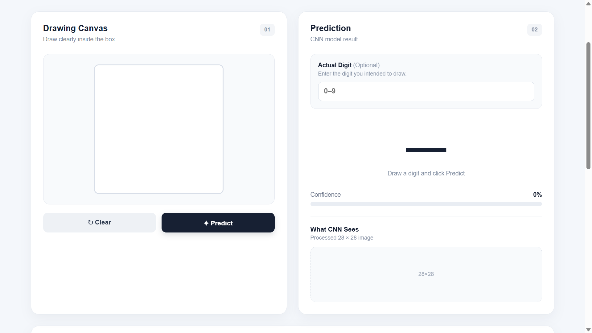
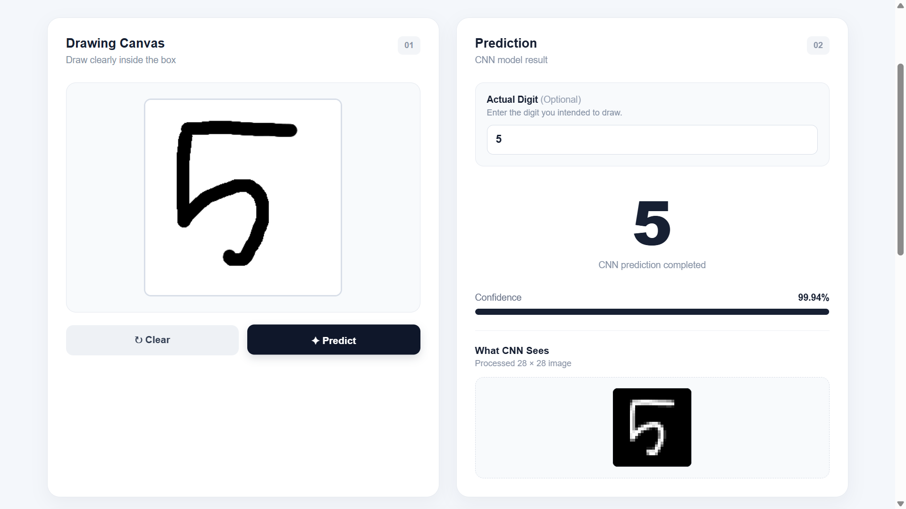
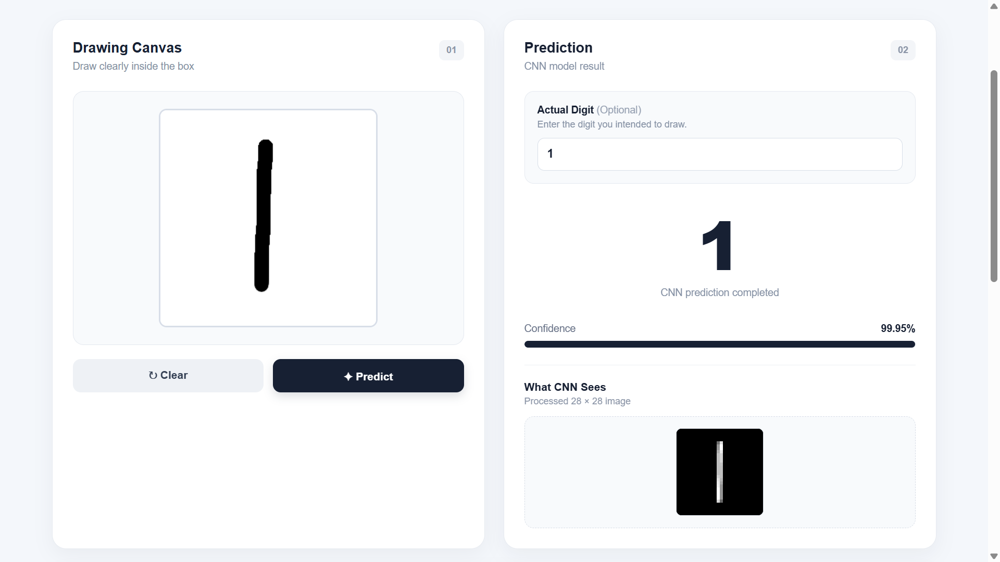
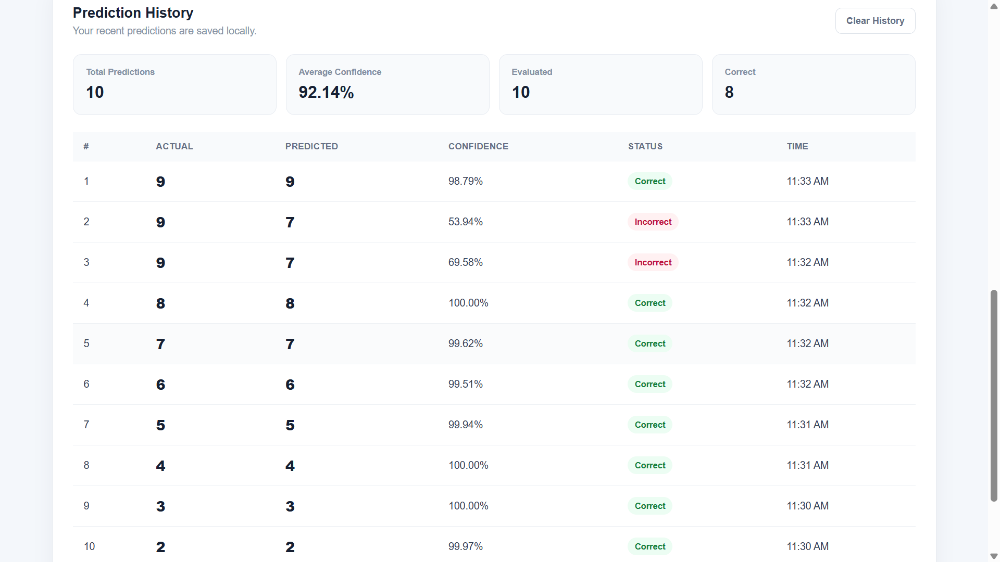

# MNIST Handwritten Digit Recognition

A web application that recognizes handwritten digits (0–9) using a Convolutional Neural Network (CNN) trained on the MNIST dataset.

## Features

* Draw a digit using an interactive canvas
* Predict handwritten digits using CNN
* Show prediction confidence
* Show the processed 28×28 image
* Enter actual digit for evaluation
* Prediction history
* Correct / Incorrect status
* LocalStorage-based history

## Technologies

* Python
* TensorFlow / Keras
* OpenCV
* NumPy
* Flask
* HTML
* CSS
* JavaScript

## Model

```text
Input (28×28×1)
      ↓
Conv2D (32)
      ↓
MaxPooling
      ↓
Conv2D (64)
      ↓
MaxPooling
      ↓
Flatten
      ↓
Dense (64)
      ↓
Dense (10)
      ↓
Softmax
```

**Test Accuracy: 98.74%**

## Project Structure

```text
mnist-digit-recognition-web-app/
│
├── app/
│   ├── __init__.py
│   ├── model.py
│   ├── preprocessing.py
│   └── routes.py
│
├── models/
│   └── mnist_cnn.keras
│
├── screenshots/
│   ├── main-interface.png
│   ├── predict-5.png
│   ├── predict-1.png
│   └── history.png
│
├── static/
│   ├── css/
│   │   └── style.css
│   └── js/
│       └── app.js
│
├── templates/
│   └── index.html
│
├── tests/
│   └── test_model.py
│
├── train/
│   └── train_model.py
│
├── .gitignore
├── README.md
├── requirements.txt
└── run.py
```

## Installation

Create and activate a virtual environment:

```cmd
python -m venv venv
venv\Scripts\activate
```

Install dependencies:

```cmd
pip install -r requirements.txt
```

## Run

```cmd
python run.py
```

Open:

```text
http://127.0.0.1:5000
```

## Screenshots

### Main Interface



### Prediction - Digit 5



### Prediction - Digit 1



### Prediction History


